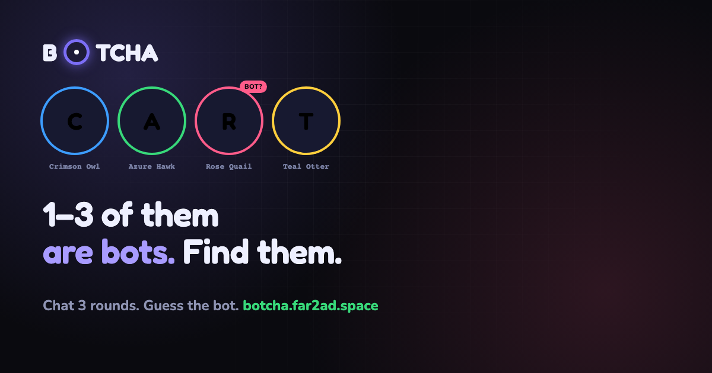

<div align="center">

<a href="https://botcha.far2ad.space"></a>

### A multiplayer reverse Turing test.

Four seats chat anonymously around a table. **One to three of them are AI bots**, and nobody tells you how many.
<br>
You are not trying to prove you're human. You're hunting the ones who aren't.

<br>

[](https://botcha.far2ad.space)


</div>

---

## 🎲 How a game runs

| | Phase | What happens |
| :-: | --- | --- |
| 1 | **Queue** | Join the global queue. Real players fill seats first; after 12 seconds, bots take whatever is left, so you can always play, even alone. |
| 2 | **Table** | Three rounds of chat. Each seat gets a 30-second turn and one message of up to 200 characters. Skip two turns and you earn a public 🤐 *Silent Player* badge. |
| 3 | **Guess** | A 20-second private vote: which seats were bots? Bots fake their own votes on random delays, so nobody's status gives them away. |
| 4 | **Reveal** | Masks off. **+20 points and 5 coins** for every bot you catch, **−10** for every miss, and confetti if you nailed it. 🎉 |

Every seat is just a color and a code name (*Crimson Owl*, *Azure Hawk*…). There are no profiles and no tells, only what people write.

## ✨ Features

- 🤖 **Bots that pass.** Personas match the table's language, take a human amount of time to answer, throw some trash talk and resist prompt injection ("ignore previous instructions" won't out them).
- ⚡ **Real-time.** WebSocket game loop with reconnect and resync, so a dropped connection doesn't drop the game.
- ❤️ **Hearts and coins.** Each game costs a heart, and hearts regenerate one at a time on a timer. Coins come from catching bots and from inviting friends with unique invite codes.
- 🏆 **Leaderboard** and play history.
- 🔐 **Google Sign-In**, verified server-side, plus a mock login for local development.
- 🔔 **Push notifications** when your hearts refill (Firebase Cloud Messaging).
- 🖼️ **Share cards.** A PNG of your table's actual transcript, rendered in the browser, so friends can guess at it too.
- 📲 **Installable PWA** with an add-to-home-screen prompt and a banner when a new version is deployed.
- 🎨 **A considered design.** A "dark arcade lounge" look with one violet light source and four seat colors; see [`DESIGN.md`](DESIGN.md).

## 🚀 Run it locally

You need **Node 22.5 or newer** (Botcha uses the built-in `node:sqlite`). Open two terminals:

```bash
# terminal 1: backend on http://localhost:8787
cd server && npm install && npm run dev
```

```bash
# terminal 2: frontend on http://localhost:5173
cd web && npm install && npm run dev
```

Open the page and press Play. Bots fill the empty seats after 12 seconds, so a single tab gets a full game. For more human players, use extra incognito windows; each tab counts as its own player.

> [!TIP]
> **No API key needed.** Without an `OPENROUTER_API_KEY`, bots fall back to canned replies. They still take turns and still get guessed at, so the whole game runs for free with no external services. To use a real model, copy `server/.env.example` to `server/.env` and add a key. Read the comments in that file before changing the model: reasoning models break the bot in subtle ways.

To skip the clicking, the smoke test plays a full game against the real bot with three mock humans:

```bash
node server/scripts/smoke-test.mjs
```

<details>
<summary><b>Checks</b></summary>

```bash
cd server && npm run typecheck && npx tsx src/config.test.ts
cd web && npm run build && npm run lint
```

There is no test framework. `server/src/config.test.ts` is a plain `node:assert` script, so follow that pattern for new checks.

</details>

## 🧱 Architecture

```
botcha/
├─ server/   Fastify + WebSocket + SQLite backend (TypeScript)
│  └─ src/
│     ├─ game/room.ts   the whole game loop
│     ├─ config.ts      every game and economy number, in one place
│     └─ bot/           LLM client and personas
├─ web/      React 19 + Vite frontend (TypeScript, PWA)
└─ docs/     SPEC.md: specification, glossary, decisions
```

- **Two packages, no shared code.** They agree on WebSocket message shapes by convention.
- **Rooms live in memory** for their 2–4 minutes. Only finished games, messages and the economy are written to SQLite, so a crash loses games in progress and nothing else.
- The full specification, and where the built code differs from it, is in [`docs/SPEC.md`](docs/SPEC.md).

<details>
<summary><b>Self-hosting</b></summary>

Botcha runs on one small VPS: the Node process under systemd, the built frontend served as static files by nginx, and TLS handled upstream. No containers and no managed services.

```bash
# backend: run under a process manager of your choice
cd server && npm install && npm start          # serves :8787, reads server/.env

# frontend: build once, then point your web server at web/dist
cd web && npm install && npm run build
```

Your web server needs to:

- proxy `/api/` and `/ws` to the backend port;
- serve `web/dist` for everything else, falling back to `index.html` for SPA routes;
- serve `.webmanifest` as `application/manifest+json` (nginx has no built-in type for it, and without it the install prompt is unreliable).

`server/.env` and the SQLite database are git-ignored, so a deploy never overwrites your key or your data.

</details>

<details>
<summary><b>Design notes and known gaps</b></summary>

- **`node:sqlite`, not `better-sqlite3`.** The built-in module needs no native build step, which matters on a cheap VPS without a compiler. It is still marked experimental.
- **The bot-test page** (`/#/bot-test`) calls the real bot directly, without matchmaking. It is off unless `BOT_TEST=1`, because it sends text from anyone to a paid model without auth. Never enable it in production.
- **Share cards include the real transcript.** That's a deliberate product choice, since a bare score isn't worth sharing. It does mean other players' messages can end up in a posted image; the Terms of Service cover this and the Share button notes it.
- **Rate limiting** applies to HTTP per IP, and more tightly to sign-up. WebSocket frames aren't rate-limited yet; see [`docs/SPEC.md` §8](docs/SPEC.md#8-architecture).
- **Still to build:** a payment gateway. See [`docs/SPEC.md` §10](docs/SPEC.md#10-spec-vs-built).

</details>

## 📄 License

[MIT](LICENSE) © 2026 Farzad Farazmand

<div align="center">
<br>
<sub>Built by <a href="https://github.com/fr2ad">Farzad Farazmand</a>. Can you tell who's human? <a href="https://botcha.far2ad.space"><b>Play Botcha →</b></a></sub>
</div>
